# Comment marche France·Sim

Ce document explique, avec des schémas, comment le simulateur fonctionne : d’où viennent les chiffres,
ce qui se passe quand on avance d’un an, et comment les variables s’influencent.
Les schémas sont en [Mermaid](https://mermaid.js.org/) : GitHub les affiche directement.

## 1. Vue d’ensemble : des fichiers ouverts, un moteur, une interface

Toutes les hypothèses sont dans des fichiers CSV du dossier `modele/`, lisibles dans un tableur.
Le moteur les lit, simule la France année par année, et l’interface montre le résultat.

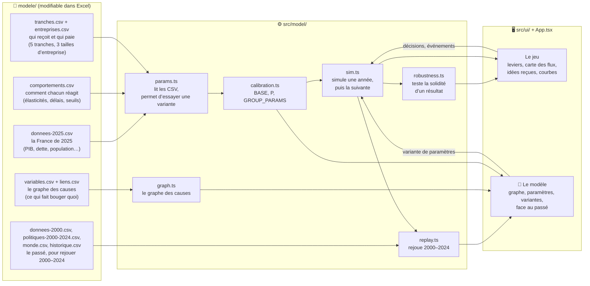

Le graphe (`variables.csv`, `liens.csv`) **décrit** le moteur pour qu’on puisse le lire et le discuter.
Le moteur (`sim.ts`) reste la référence : des tests vérifient que chaque lien cite des paramètres qui existent,
et que chaque paramètre des fichiers est vraiment utilisé.

## 2. Une partie : vos choix comparés à « si on n’avait rien changé »

À chaque affichage, le simulateur refait tout le chemin depuis 2025, deux fois :
une fois avec vos décisions, une fois sans. Tous les écarts affichés sont la différence entre les deux.
C’est ce qui permet de dire « la pauvreté baisse de 1,2 point **à cause de** votre décision »,
même quand le monde change en même temps (crise, pétrole, vieillissement).

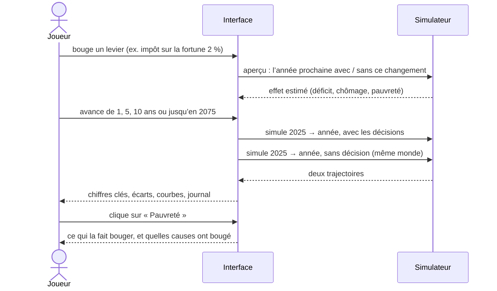

## 3. Une année dans le moteur

Chaque année suit le même ordre. L’étape 4 est une recherche d’équilibre : la production dépend de la demande,
qui dépend des revenus, qui dépendent de la production. Le moteur tâtonne (jusqu’à 60 essais) jusqu’à ce que tout boucle.

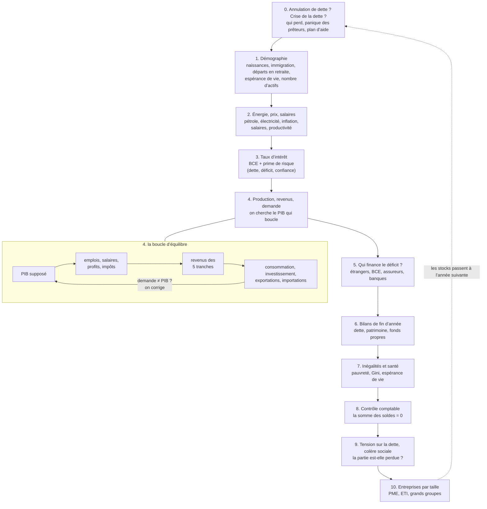

## 4. Où circule l’argent (le modèle stock-flux)

Chaque euro a un payeur et un receveur. La somme des excédents et des déficits de tous les acteurs est nulle chaque année :
si l’État est en déficit, quelqu’un d’autre (ménages, entreprises ou reste du monde) a épargné le montant correspondant.
C’est le principe des modèles « stock-flux cohérents » (Godley et Lavoie), et un test le vérifie chaque année.

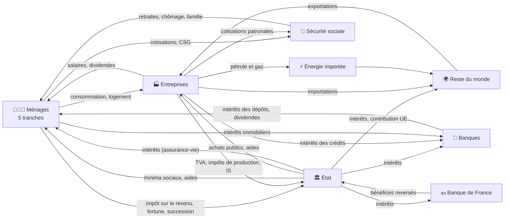

## 5. Le graphe des causes, en version simplifiée

Le graphe complet (85 variables, 200 liens) est dans l’application, onglet « 🧠 Le modèle ».
Voici ses grandes boucles. Un lien « + » veut dire « quand l’un monte, l’autre monte » ; « − » : « quand l’un monte, l’autre baisse ».

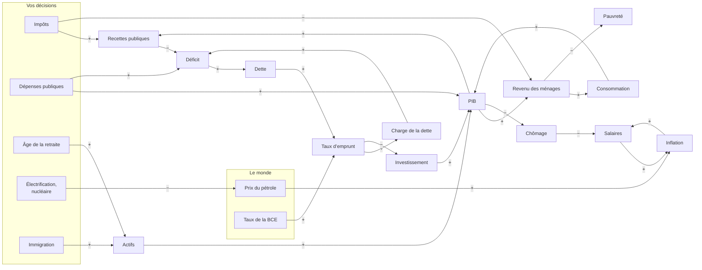

Trois boucles expliquent l’essentiel de ce qu’on voit en jouant :

- **Le multiplicateur** (revenu → consommation → PIB → revenu) : une dépense publique ou une baisse d’impôt soutient l’activité,
  d’autant plus qu’elle va à des ménages modestes, qui dépensent presque tout ce qu’ils reçoivent.
- **La boucle salaires-prix** (chômage → salaires → inflation → salaires) : quand le chômage passe sous 7 %,
  les salaires accélèrent et les prix suivent ; un choc pétrolier lance la même spirale par les prix.
- **La boule de neige de la dette** (déficit → dette → taux → intérêts → déficit) : quand le taux payé dépasse la croissance,
  la dette grossit d’elle-même, même sans nouvelle dépense. Le journal de la partie signale le moment où cela arrive.

## 6. Les ménages : de 5 tranches à la pauvreté et aux inégalités

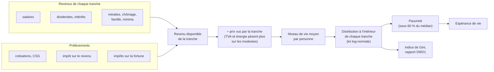

## 7. Le climat

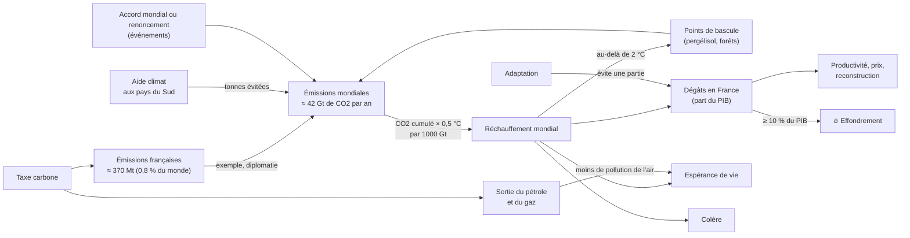

Sans changement de politique dans le monde, le réchauffement atteint environ +1,8 °C en 2050 et +2,3 °C en 2075
(soit une trajectoire vers +2,7 °C en 2100, comme l’estime l’ONU). Les chiffres viennent du GIEC (AR6), du Global Carbon Budget,
de l’ONU Environnement, du Citepa et de Santé publique France ; les fonctions de dégâts sont des hypothèses, à discuter.

## 8. L’immigration : tout est cause et effet

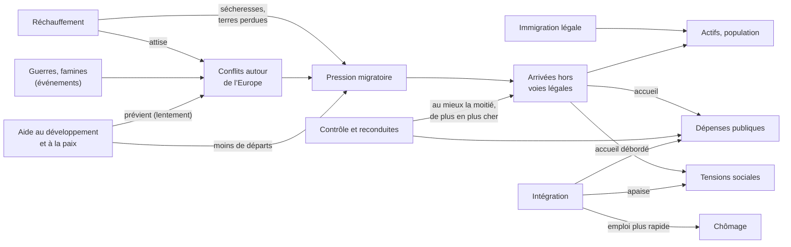

Le contrôle des frontières a des rendements décroissants : on n’empêche au mieux que la moitié des arrivées irrégulières, et la pression revient
tant que guerres, misère et réchauffement poussent au départ. L’aide au développement et la lutte contre le réchauffement agissent sur les causes,
mais sur des décennies. Toutes ces règles sont dans `modele/comportements.csv` (bloc Immigration), avec leurs sources ou leur statut d’hypothèse.

## 9. L’influence de la France

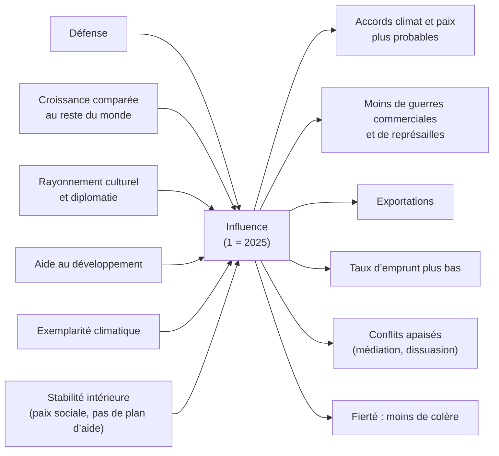

L’influence suit la puissance avec retard (quelques années). Sans rien faire, elle s’érode doucement : le monde croît plus vite que la France.
Toutes les pondérations et tous les effets sont dans `modele/comportements.csv` (bloc Influence) ; ce sont des hypothèses, inspirées des indices
de puissance (Lowy Institute) et de soft power.

## 10. Comprendre pourquoi : causes, combinaisons, effets émergents

Le jeu ne raconte rien d’écrit à l’avance : il mesure.

- **Pourquoi un événement arrive** : chaque probabilité est une somme de raisons nommées (« 8 % de base, +12 % parce que la planète
  a pris 0,4 °C, ×0,8 grâce à votre aide au développement »). Les mêmes raisons servent au tirage au sort et à l’explication.
- **Pourquoi la France en est là** : le bouton « 🔍 Pourquoi en est-on là ? » de la une rejoue la partie en retirant, une à une,
  chaque décision et chaque événement. La différence est la part de chacun. Ce qui reste une fois tout additionné est
  l’**effet de combinaison** : des causes qui se renforcent ou s’amortissent entre elles, sans qu’aucune règle ne l’ait prévu.

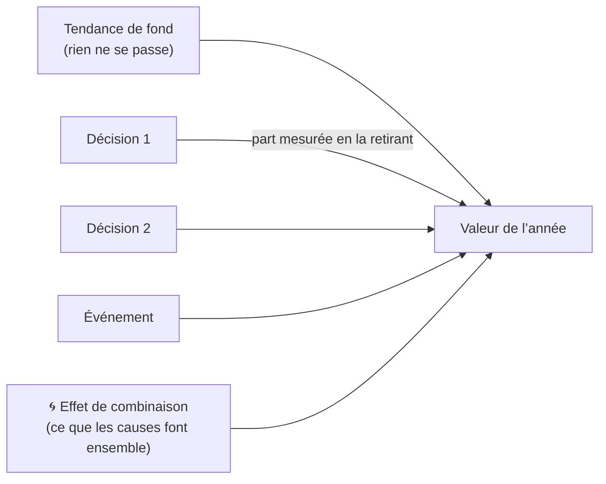

Tendance + parts de chaque cause + effet de combinaison = la valeur réelle, exactement (un test le vérifie).

## 11. Le monde bouge, le Parlement freine

- **Événements** : chaque année, 24 événements possibles sont tirés au sort (une partie différente à chaque fois). Leur probabilité
  dépend de la situation : plus il fait chaud, plus il y a de canicules et de sécheresses ; plus la colère monte, plus il y a de grèves ;
  une France qui réduit ses émissions rend un accord climatique mondial plus probable.
- **Capital politique** : chaque réforme coûte des points selon son ampleur et son poids politique (âge de la retraite, nationalisations,
  réglementation coûtent double). Les points dépendent de la popularité, avec un bonus juste après une élection.
- **Modèle économique** : nationaliser (l’État rachète en obligations, touche les dividendes, oriente l’investissement, mais perd en efficacité
  et fait fuir des capitaux) ou privatiser ; réglementer (protège les salaires du bas et les émissions, mais relève le chômage d’équilibre
  et freine la productivité) ou libéraliser.

## 12. Crise de la dette et fin de partie

Une partie peut mal finir. Le moteur suit deux jauges, et quatre façons de perdre.

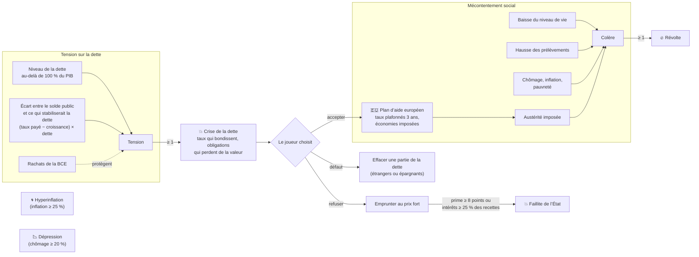

Quand les impôts s’envolent, une partie échappe au fisc (fraude, travail au noir) et les hauts revenus partent :
chaque hausse rapporte de moins en moins. Tous les seuils sont dans `modele/comportements.csv`, avec leur plage plausible.

## 13. Les entreprises : PME, ETI, grands groupes

Le moteur garde une seule économie, mais chaque taille d’entreprise réagit à sa façon (`modele/entreprises.csv`) :
les PME dépendent de leur banque et emploient plus de salariés au SMIC ; les ETI portent l’industrie qui consomme de l’énergie ;
les grands groupes exportent et peuvent déclarer leurs bénéfices ailleurs. Une aide publique est en partie investie :
beaucoup par une PME qui manque de trésorerie, peu par un grand groupe. Le levier « Part des aides allant aux PME » le montre.

## 14. Le test de vérité : rejouer 2000–2024

Le même moteur repart de la France de 2000 (`donnees-2000.csv`), avec les décisions réellement prises
(`politiques-2000-2024.csv`) et le monde tel qu’il a été (`monde.csv`). On compare à ce qui s’est passé (`historique.csv`).

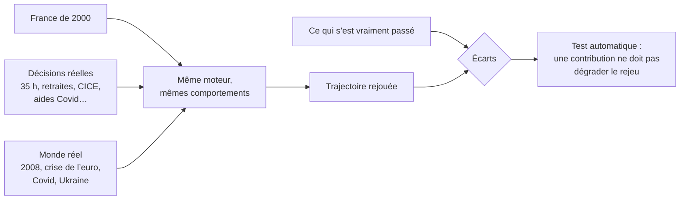

Aujourd’hui, l’écart moyen est d’environ 1,7 point sur la croissance et le chômage, 1,2 sur l’inflation, 1,5 sur le déficit,
0,4 sur le taux à 10 ans ; la dette de 2024 est retrouvée à une dizaine de points près. Ce rejeu a permis de corriger
plusieurs défauts : un impôt sur le revenu deux fois et demie trop lourd, des chocs pétroliers qui ne touchaient que la France,
des taux longs qui suivaient trop vite la BCE. L’onglet « Face au passé » du modèle montre les courbes, et dit si votre variante
de paramètres reproduit mieux ou moins bien l’histoire.

## 15. Ce résultat est-il solide ?

Pour une décision et un indicateur, on refait le calcul en faisant varier chaque **hypothèse** du modèle (les paramètres
dont la fiabilité est « hypothèse ») dans sa plage plausible (colonnes `min` et `max`, sinon ± 30 %). Verdict :

- **solide** : le sens et l’ampleur de l’effet tiennent ;
- **à nuancer** : le sens tient, l’ampleur dépend d’hypothèses ;
- **fragile** : l’effet peut changer de sens selon une hypothèse incertaine.

L’analyse nomme les hypothèses qui décident : ce sont elles qu’il faut documenter en priorité.

## 16. Participer : du tableur au modèle

Voir [CONTRIBUER.md](../CONTRIBUER.md) pour le détail, et la documentation HTML (`docs/index.html`) pour les guides pas à pas.

## 17. Ce que le modèle ne sait pas faire (limites connues)

Un simulateur honnête dit où il s’arrête. Les principales limites aujourd’hui :

- **Les prévisions au-delà de 15 ans sont des tendances.** Après 2040, l’interface grise les courbes :
  la démographie et la dette y sont crédibles, l’innovation, le climat ou la géopolitique non.
- **La Banque centrale européenne ne réagit pas à la France.** Son taux est fixé par le scénario mondial :
  une politique très inflationniste en France n’entraîne pas de hausse des taux de la BCE.
- **Les crises et la colère sociale suivent des seuils.** Ce sont des ordres de grandeur tirés de l’histoire (Grèce, Italie,
  gilets jaunes), pas des lois : leurs paramètres sont des hypothèses, à discuter.
- **Les entreprises ne forment qu’une économie.** Les trois tailles ont des sensibilités différentes, mais pas de secteurs
  (industrie, services, agriculture) ni de faillites d’entreprises.
- **Les inégalités sont reconstituées à partir de 5 tranches.** La pauvreté de départ (≈ 14,7 %) est proche de l’INSEE (15,4 %),
  mais l’indice de Gini (≈ 0,33) est plus élevé que celui de l’INSEE (0,29), car les tranches viennent des comptes nationaux
  « distribués », qui comptent plus largement les revenus du capital.
- **Le rejeu 2000–2024 rate certaines périodes** : le chômage de 2014-2018, la croissance de 2022-2024 (le bouclier tarifaire
  et l’énigme de la productivité ne sont pas modélisés). Les données de 2000 et l’historique sont des ordres de grandeur arrondis,
  à vérifier.
- **Beaucoup de comportements sont des hypothèses.** Leur colonne `fiabilite` le dit, et l’analyse de solidité montre
  lesquelles comptent : c’est là que les contributions sont les plus utiles.
