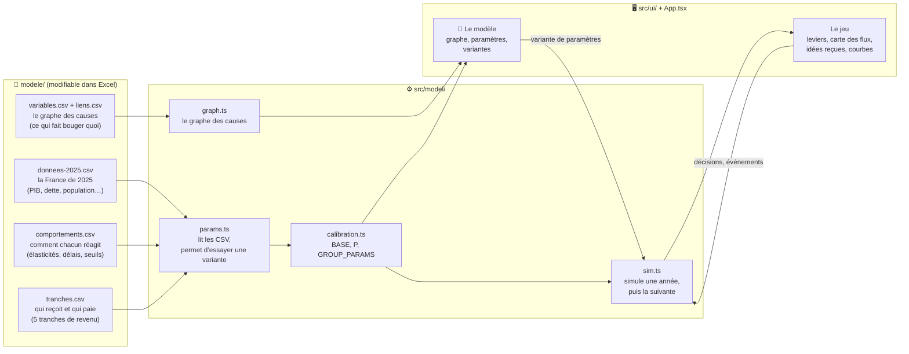
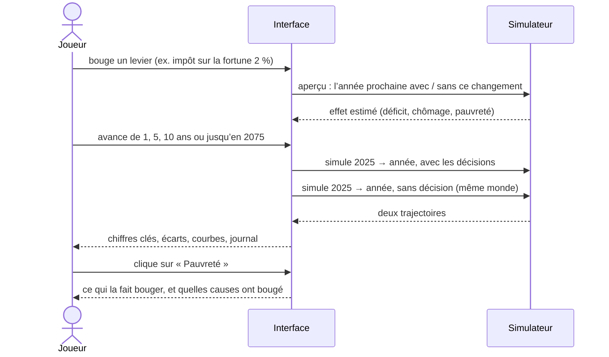
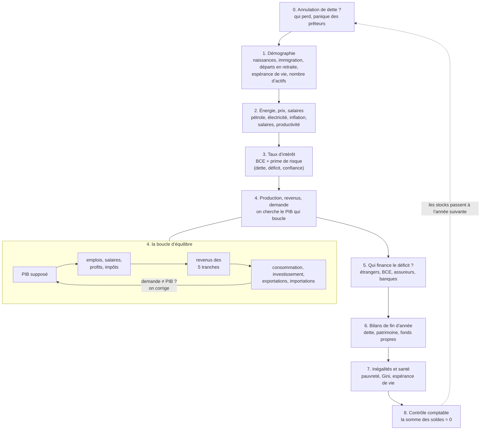
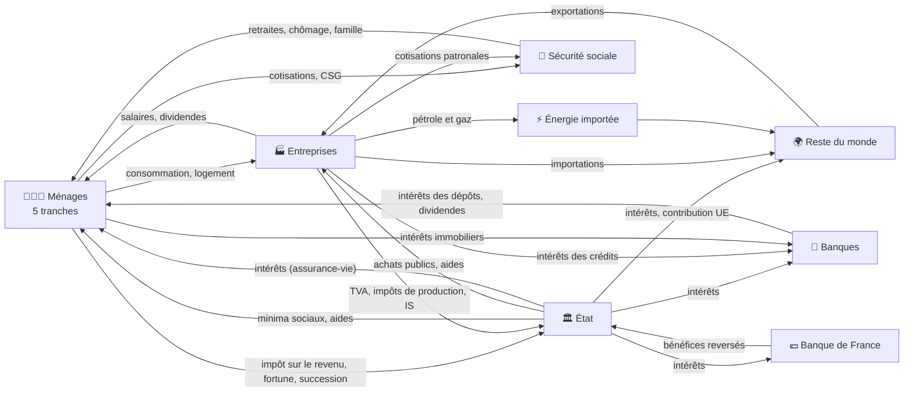
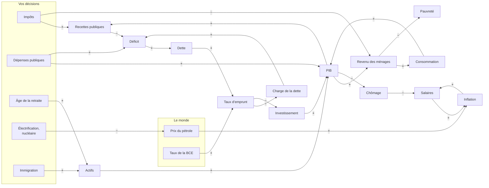
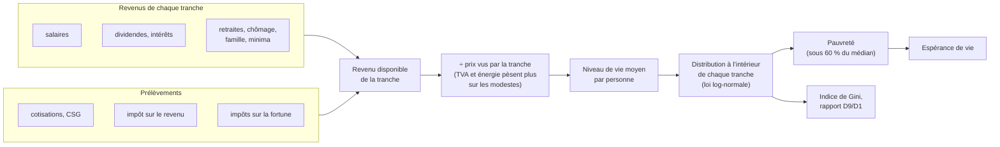
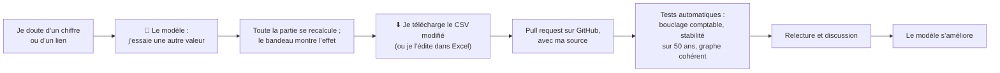

# Comment marche France·Sim

Ce document explique, avec des schémas, comment le simulateur fonctionne : d’où viennent les chiffres,
ce qui se passe quand on avance d’un an, et comment les variables s’influencent.
Les schémas sont en [Mermaid](https://mermaid.js.org/) : GitHub les affiche directement.

## 1. Vue d’ensemble : des fichiers ouverts, un moteur, une interface

Toutes les hypothèses sont dans des fichiers CSV du dossier `modele/`, lisibles dans un tableur.
Le moteur les lit, simule la France année par année, et l’interface montre le résultat.

Le graphe (`variables.csv`, `liens.csv`) **décrit** le moteur pour qu’on puisse le lire et le discuter.
Le moteur (`sim.ts`) reste la référence : des tests vérifient que chaque lien cite des paramètres qui existent,
et que chaque paramètre des fichiers est vraiment utilisé.

## 2. Une partie : vos choix comparés à « si on n’avait rien changé »

À chaque affichage, le simulateur refait tout le chemin depuis 2025, deux fois :
une fois avec vos décisions, une fois sans. Tous les écarts affichés sont la différence entre les deux.
C’est ce qui permet de dire « la pauvreté baisse de 1,2 point **à cause de** votre décision »,
même quand le monde change en même temps (crise, pétrole, vieillissement).

## 3. Une année dans le moteur

Chaque année suit le même ordre. L’étape 4 est une recherche d’équilibre : la production dépend de la demande,
qui dépend des revenus, qui dépendent de la production. Le moteur tâtonne (jusqu’à 60 essais) jusqu’à ce que tout boucle.

## 4. Où circule l’argent (le modèle stock-flux)

Chaque euro a un payeur et un receveur. La somme des excédents et des déficits de tous les acteurs est nulle chaque année :
si l’État est en déficit, quelqu’un d’autre (ménages, entreprises ou reste du monde) a épargné le montant correspondant.
C’est le principe des modèles « stock-flux cohérents » (Godley et Lavoie), et un test le vérifie chaque année.

## 5. Le graphe des causes, en version simplifiée

Le graphe complet (75 variables, plus de 150 liens) est dans l’application, onglet « 🧠 Le modèle ».
Voici ses grandes boucles. Un lien « + » veut dire « quand l’un monte, l’autre monte » ; « − » : « quand l’un monte, l’autre baisse ».

Trois boucles expliquent l’essentiel de ce qu’on voit en jouant :

- **Le multiplicateur** (revenu → consommation → PIB → revenu) : une dépense publique ou une baisse d’impôt soutient l’activité,
  d’autant plus qu’elle va à des ménages modestes, qui dépensent presque tout ce qu’ils reçoivent.
- **La boucle salaires-prix** (chômage → salaires → inflation → salaires) : quand le chômage passe sous 7 %,
  les salaires accélèrent et les prix suivent ; un choc pétrolier lance la même spirale par les prix.
- **La boule de neige de la dette** (déficit → dette → taux → intérêts → déficit) : quand le taux payé dépasse la croissance,
  la dette grossit d’elle-même, même sans nouvelle dépense. Le journal de la partie signale le moment où cela arrive.

## 6. Les ménages : de 5 tranches à la pauvreté et aux inégalités

## 7. Participer : du tableur au modèle

Voir [CONTRIBUER.md](../CONTRIBUER.md) pour le détail.

## 8. Ce que le modèle ne sait pas faire (limites connues)

Un simulateur honnête dit où il s’arrête. Les principales limites aujourd’hui :

- **Les prévisions au-delà de 15 ans sont des tendances.** Après 2040, l’interface grise les courbes :
  la démographie et la dette y sont crédibles, l’innovation, le climat ou la géopolitique non.
- **La Banque centrale européenne ne réagit pas à la France.** Son taux est fixé par le scénario mondial :
  une politique très inflationniste en France n’entraîne pas de hausse des taux de la BCE.
- **Pas de crise de la dette automatique.** La prime de risque monte avec la dette, mais rien ne déclenche une crise brutale
  quand la dette dépasse 200 % du PIB : en réalité, les prêteurs refuseraient bien avant. Le journal signale l’effet boule de neige.
- **Les entreprises forment un seul bloc.** Pas encore de distinction entre PME, ETI et grands groupes, ni entre secteurs.
- **La pauvreté de départ est un peu sous-estimée** (≈ 13 % contre 15,4 % mesurés par l’INSEE), car on reconstitue
  la distribution à partir de 5 tranches.
- **Les comportements sont des moyennes stables.** Le modèle ne capte pas les changements d’habitudes brutaux
  (fuite massive des capitaux, révolte fiscale, effondrement de la confiance), au-delà de plafonds prudents.
- **Pas de calage sur 2000–2024.** Le modèle part de 2025 ; le rejouer sur le passé est la prochaine étape pour le valider.
- **Beaucoup de comportements sont des hypothèses.** Leur colonne `fiabilite` le dit : c’est là que les contributions sont les plus utiles.
